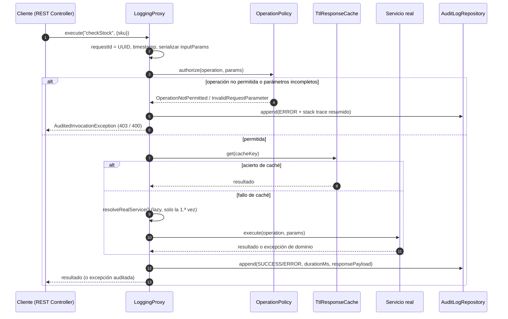
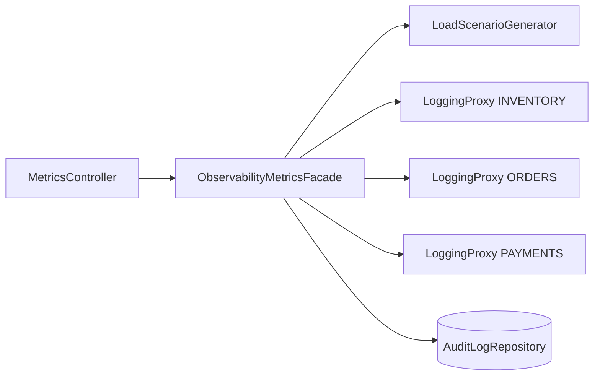
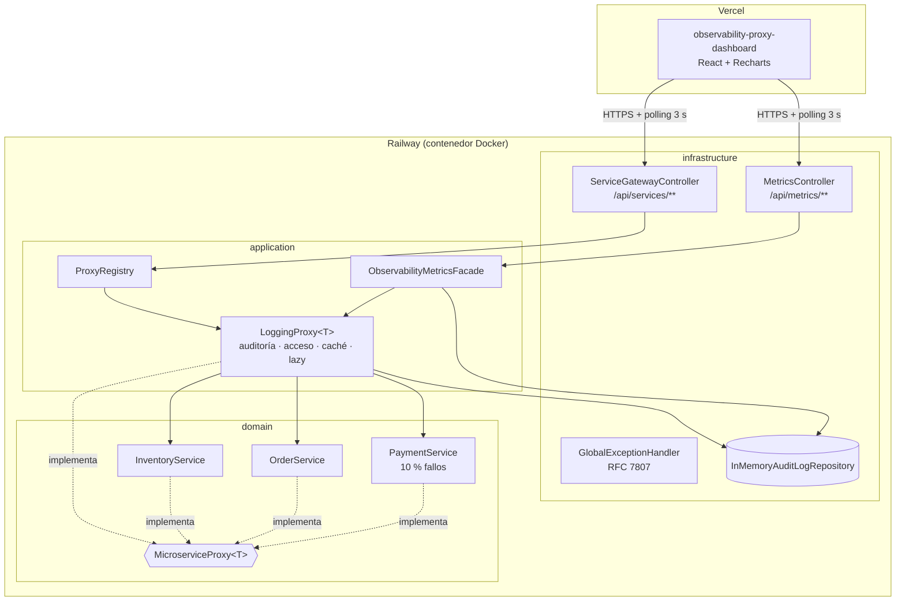
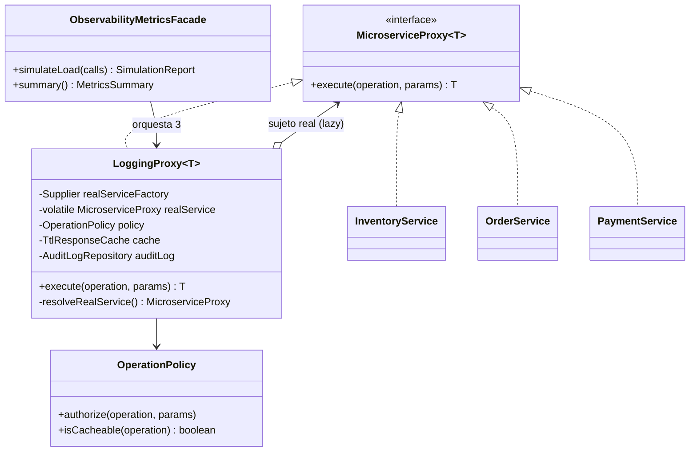

# microservice-logging-proxy-api

**Sistema de monitoreo de microservicios con Proxy de auditoría y logging** — Backend.

API REST en **Spring Boot 3.3 / Java 21** que simula tres microservicios de un e-commerce de tecnología (Inventario, Pedidos y Pagos) y antepone a cada uno un **`LoggingProxy`** que audita cada llamada, controla el acceso, cachea lecturas y difiere la creación del servicio real hasta que se necesita. Las métricas resultantes alimentan el dashboard [`observability-proxy-dashboard`](../observability-proxy-dashboard), desplegado en Vercel.

> Proyecto académico — Ingeniería de Software, 4.º semestre. Tema: **Patrón de Diseño Estructural Proxy** (y su contraste con **Facade**).

---

## Tabla de contenido

1. [El patrón Proxy en este proyecto](#1-el-patrón-proxy-en-este-proyecto)
2. [Proxy vs. Facade](#2-proxy-vs-facade)
3. [Arquitectura](#3-arquitectura)
4. [Estructura del repositorio](#4-estructura-del-repositorio)
5. [Endpoints](#5-endpoints)
6. [Ejecución local](#6-ejecución-local)
7. [Despliegue en Railway](#7-despliegue-en-railway)
8. [Variables de entorno](#8-variables-de-entorno)
9. [Decisiones de diseño](#9-decisiones-de-diseño)

---

## 1. El patrón Proxy en este proyecto

Un **Proxy** es un objeto que implementa **la misma interfaz** que otro objeto (el *sujeto real*) y se interpone entre él y sus clientes para **controlar el acceso**. Como la interfaz es idéntica, el cliente no puede distinguir si habla con el proxy o con el objeto real.

### 1.1 Participantes

| Rol del patrón | Clase en el proyecto |
|---|---|
| **Subject** (interfaz común) | `domain.port.MicroserviceProxy<T>` |
| **RealSubject** | `InventoryService`, `OrderService`, `PaymentService` |
| **Proxy** | `application.proxy.LoggingProxy<T>` |
| **Client** | `ServiceGatewayController` y `ObservabilityMetricsFacade` |

```java
public interface MicroserviceProxy<T> {
    T execute(String operation, Object... params);
}
```

### 1.2 Las cuatro responsabilidades del `LoggingProxy`

| Variante clásica del Proxy | Cómo se implementa |
|---|---|
| **Proxy de registro / auditoría** | Genera un `requestId` (UUID), toma el `timestamp`, serializa `inputParams`, mide `durationMs` con `System.nanoTime()` y guarda `responsePayload` (respuesta completa o error + *stack trace* resumido a 4 líneas). |
| **Proxy de protección** (control de acceso) | `OperationPolicy` rechaza operaciones no expuestas (HTTP 403) o con parámetros obligatorios faltantes (HTTP 400) **antes** de tocar el servicio real. El rechazo también queda auditado. |
| **Proxy virtual** (carga diferida) | El servicio real se recibe como `Supplier<MicroserviceProxy<T>>` y solo se instancia en la primera llamada válida, igual que el ejemplo de clase `if (realProfile == null) realProfile = new RealProfile();`, pero *thread-safe* (doble verificación con `ReentrantLock`). La inicialización queda registrada en el log y expuesta en `/api/metrics/summary` (`realServiceInitialized`, `realServiceInitializedAt`). |
| **Proxy de caché** | `checkStock` se responde desde una caché `ConcurrentHashMap` con TTL de 5 s. Cualquier operación de escritura (`reserveStock`, `restockItem`) invalida la caché. Los aciertos se auditan con `cacheHit: true`. |

### 1.3 Flujo de una llamada



### 1.4 Ventajas y desventajas

**Ventajas**

- **Control de acceso**: las operaciones no autorizadas nunca llegan al servicio real.
- **Carga diferida (lazy loading)**: los recursos costosos solo se crean cuando se usan.
- **Caché**: reduce latencia y carga sobre el servicio real en lecturas repetidas.
- **Interfaz común / transparencia**: el cliente no cambia al introducir o retirar el proxy.
- **Responsabilidad única / abierto-cerrado**: la auditoría se añade sin modificar ni una línea de los servicios reales.

**Desventajas**

- **Complejidad**: más clases (proxy, política, caché, serializador, registro).
- **Sobrecarga**: cada llamada paga serialización JSON y escritura en el log (unos pocos ms).
- **Diseño adicional**: hay que resolver concurrencia en la inicialización diferida, invalidación de caché y cómo devolver metadatos (el `requestId`) sin romper la interfaz común.

---

## 2. Proxy vs. Facade

Ambos patrones estructurales se colocan "delante" de otros objetos, pero con intenciones opuestas. El proyecto los usa juntos:

| | **Proxy** (`LoggingProxy<T>`) | **Facade** (`ObservabilityMetricsFacade`) |
|---|---|---|
| Interfaz | **La misma** que el objeto real (`MicroserviceProxy<T>`) | **Nueva y simplificada** (`simulateLoad`, `summary`, `reset`) |
| Envuelve a | **Un** objeto | **Varios** subsistemas (3 proxies + generador de carga + repositorio de auditoría) |
| Propósito | Controlar el acceso (auditar, cachear, diferir, proteger) | Ocultar la complejidad de orquestar subsistemas |
| ¿El cliente lo nota? | No: es intercambiable con el objeto real | Sí: el cliente usa la fachada explícitamente |



La fachada habla con los **proxies**, nunca con los servicios reales: así toda la carga simulada también queda auditada.

---

## 3. Arquitectura

Arquitectura hexagonal ligera: el dominio no depende de Spring; la infraestructura adapta HTTP y almacenamiento.



### Diagrama de clases (núcleo del patrón)



---

## 4. Estructura del repositorio

```
microservice-logging-proxy-api/
├── Dockerfile                     # build multi-stage (Maven → JRE Alpine)
├── railway.json                   # builder Dockerfile + healthcheck
├── pom.xml
├── docs/api-examples.http         # peticiones listas para VS Code / IntelliJ
└── src/
    ├── main/java/com/monitoring/proxyapi/
    │   ├── domain/
    │   │   ├── model/             # ServiceId, AuditLogEntry, OperationParameters, ProductCatalog...
    │   │   ├── exception/         # excepciones de dominio + ErrorCategory
    │   │   ├── port/              # MicroserviceProxy<T>, AuditLogRepository
    │   │   └── service/           # sujetos reales: inventory, orders, payments
    │   ├── application/
    │   │   ├── proxy/             # LoggingProxy, OperationPolicy, TtlResponseCache, serializador...
    │   │   ├── facade/            # ObservabilityMetricsFacade, LoadScenarioGenerator
    │   │   └── metrics/           # DTOs de métricas
    │   └── infrastructure/
    │       ├── rest/              # controladores, manejador de errores, DTOs HTTP
    │       ├── persistence/       # InMemoryAuditLogRepository
    │       └── config/            # composición de beans, CORS, propiedades
    ├── main/resources/application.yml
    └── test/                      # pruebas unitarias e integración (15 casos)
```

---

## 5. Endpoints

Base local: `http://localhost:8080`

| Método | Ruta | Descripción |
|---|---|---|
| `POST` | `/api/services/inventory/{operation}` | `checkStock`, `reserveStock`, `restockItem` vía proxy |
| `POST` | `/api/services/orders/{operation}` | `createOrder`, `cancelOrder`, `getOrderStatus` vía proxy |
| `POST` | `/api/services/payments/{operation}` | `processPayment`, `refundPayment`, `validatePaymentMethod` vía proxy (10 % de fallo aleatorio) |
| `GET` | `/api/services/catalog` | Operaciones expuestas, parámetros obligatorios y payload de ejemplo |
| `GET` | `/api/metrics/summary` | Métricas por servicio + últimas 20 llamadas |
| `GET` | `/api/metrics/logs` | Logs filtrables: `service`, `status`, `from`, `to`, `page`, `size` (máx. 100) |
| `GET` | `/api/metrics/logs/{requestId}` | Detalle de una llamada |
| `POST` | `/api/metrics/simulate-load?calls=50` | Genera llamadas aleatorias concurrentes por los 3 proxies |
| `DELETE` | `/api/metrics/logs` | Reinicia logs y contadores (útil antes de una demo) |
| `GET` | `/actuator/health` | Healthcheck para Railway |

### 5.1 Forzar errores para la demo (> 15 %)

- `"forceFail": true` en cualquier operación de pagos → falla siempre con `PaymentGatewayException` (HTTP 502).
- `"stressFactor": 1..5` → multiplica la tasa base de 10 % (tope 60 %).

```bash
curl -X POST http://localhost:8080/api/services/payments/processPayment \
  -H "Content-Type: application/json" \
  -d '{"orderId":"ORD-2026-001041","amount":459900,"method":"NEQUI","forceFail":true}'
```

### 5.2 Ejemplo: `GET /api/metrics/summary`

```json
{
  "generatedAt": "2026-10-30T20:25:59.120Z",
  "degradationThresholdPercent": 15.0,
  "totalCalls": 53,
  "services": {
    "PAYMENTS": {
      "serviceId": "PAYMENTS",
      "totalCalls": 20,
      "successfulCalls": 16,
      "failedCalls": 4,
      "successRate": 80.0,
      "errorRate": 20.0,
      "avgResponseTimeMs": 241.7,
      "degraded": true,
      "cacheHits": 0,
      "realServiceInitialized": true,
      "realServiceInitializedAt": "2026-10-30T20:25:57.702Z",
      "last20Calls": [
        { "requestId": "0be1d173-...", "operation": "processPayment", "durationMs": 226, "status": "ERROR", "timestamp": "2026-10-30T20:25:59.015Z", "cacheHit": false }
      ]
    }
  }
}
```

### 5.3 Ejemplo: entrada de log con error

```json
{
  "requestId": "0be1d173-060a-4037-80ba-57a2d953faaa",
  "serviceId": "PAYMENTS",
  "operation": "processPayment",
  "durationMs": 226,
  "status": "ERROR",
  "timestamp": "2026-10-30T20:25:59.015Z",
  "inputParams": "{\"orderId\":\"ORD-2026-001041\",\"amount\":459900,\"method\":\"NEQUI\",\"forceFail\":true}",
  "responsePayload": "{\"error\":\"PaymentGatewayException\",\"errorCode\":\"PAYMENT_GATEWAY_UNAVAILABLE\",\"message\":\"[Redeban-Switch] Forced outage...\",\"stackTrace\":[\"...\"]}",
  "stackTraceSummary": "com.monitoring.proxyapi.domain.exception.PaymentGatewayException: ...\nat ...PaymentService.simulateGatewayInstability(PaymentService.java:81)\n...",
  "cacheHit": false
}
```

### 5.4 Códigos HTTP de error

Las respuestas de error usan el formato estándar **RFC 7807** (`application/problem+json`) e incluyen `requestId`, `serviceId`, `operation` y `errorCode`. El mismo `requestId` viaja en la cabecera `X-Request-Id`.

| Categoría de dominio | HTTP | Ejemplos |
|---|---|---|
| `INVALID_REQUEST` | 400 | `INVALID_PARAMETER` |
| `ACCESS_DENIED` | 403 | `OPERATION_NOT_PERMITTED` |
| `NOT_FOUND` | 404 | `PRODUCT_NOT_FOUND`, `ORDER_NOT_FOUND`, `TRANSACTION_NOT_FOUND` |
| `CONFLICT` | 409 | `INSUFFICIENT_STOCK`, `ILLEGAL_ORDER_STATE` |
| `BUSINESS_RULE_VIOLATION` | 422 | `AMOUNT_LIMIT_EXCEEDED`, `REFUND_EXCEEDS_CAPTURE` |
| `UPSTREAM_FAILURE` | 502 | `PAYMENT_GATEWAY_UNAVAILABLE` |

---

## 6. Ejecución local

**Requisitos:** JDK 21 y Maven 3.9+ (o solo Docker).

```bash
mvn spring-boot:run
```

```bash
mvn test
```

Con Docker:

```bash
docker build -t logging-proxy-api .
```

```bash
docker run -p 8080:8080 logging-proxy-api
```

Luego abre `docs/api-examples.http` en VS Code (extensión *REST Client*) o IntelliJ y ejecuta las peticiones.

---

## 7. Despliegue en Railway

1. **Sube el repositorio a GitHub** como `microservice-logging-proxy-api` (repositorio independiente del frontend).
2. En [railway.com](https://railway.com) → **New Project** → **Deploy from GitHub repo** → elige el repositorio.
3. Railway detecta `railway.json` y construye con el **Dockerfile** multi-stage. No hay que configurar comando de inicio.
4. En **Variables** del servicio agrega:
   - `CORS_ALLOWED_ORIGINS` = `http://localhost:5173,https://*.vercel.app` (o el dominio exacto de tu dashboard).
   - `PORT` lo inyecta Railway automáticamente; la app lo lee con `server.port=${PORT:8080}`.
5. En **Settings → Networking** pulsa **Generate Domain**. Obtendrás algo como `https://microservice-logging-proxy-api-production.up.railway.app`.
6. Verifica: `https://<tu-dominio>.up.railway.app/actuator/health` debe responder `{"status":"UP"}`.
7. Copia esa URL: será el valor de `VITE_API_URL` en el proyecto de Vercel del dashboard.

> El almacenamiento de auditoría es en memoria: no necesitas añadir base de datos en Railway. Al reiniciar el contenedor los logs se vacían (comportamiento esperado para una demo).

---

## 8. Variables de entorno

| Variable | Por defecto | Uso |
|---|---|---|
| `PORT` | `8080` | Puerto HTTP (Railway lo define) |
| `CORS_ALLOWED_ORIGINS` | `http://localhost:5173,https://*.vercel.app` | Orígenes permitidos (admite patrones) |
| `PAYMENT_FAILURE_RATE` | `0.10` | Probabilidad base de fallo de la pasarela |
| `PROXY_CACHE_ENABLED` | `true` | Activa la caché del proxy |
| `PROXY_CACHE_TTL` | `5s` | Vida de cada entrada en caché |
| `AUDIT_LOG_CAPACITY` | `10000` | Máximo de entradas retenidas en memoria |

---

## 9. Decisiones de diseño

- **Servicios reales fuera del contenedor de Spring.** Si fueran `@Service`, Spring los crearía al arrancar y la carga diferida del proxy no tendría sentido. `ProxyConfiguration` entrega a cada proxy un `Supplier`.
- **`ReentrantLock` en lugar de `synchronized`** para la inicialización diferida: en JDK 21 un hilo virtual bloqueado dentro de `synchronized` *fija* (pin) su hilo portador.
- **Hilos virtuales** (`spring.threads.virtual.enabled=true` y `Executors.newVirtualThreadPerTaskExecutor()` en la simulación): las latencias simuladas de 25–320 ms con `Thread.sleep` no bloquean hilos del sistema operativo; 50 llamadas concurrentes terminan en menos de 1 s.
- **Stack trace resumido**: se recorre hasta la causa raíz y se conservan las primeras 4 líneas del código propio (excluyendo el propio proxy), descartando el ruido de Tomcat, CGLIB y reflexión.
- **Enmascarado de datos sensibles**: `cardNumber`, `cvv`, `token`, etc. se guardan como `************1111`; un log de auditoría con PAN en claro entraría en el alcance de PCI DSS.
- **`requestId` sin romper la interfaz**: el proxy lo publica en un `ThreadLocal` (`InvocationContext`) que el controlador lee para la cabecera `X-Request-Id`; en errores viaja dentro de `AuditedInvocationException`.
- **Repositorio en memoria con `ConcurrentLinkedDeque` + `LongAdder`**: escrituras O(1) sin bloqueos y métricas agregadas sin recorrer el log en cada *polling* de 3 s.
